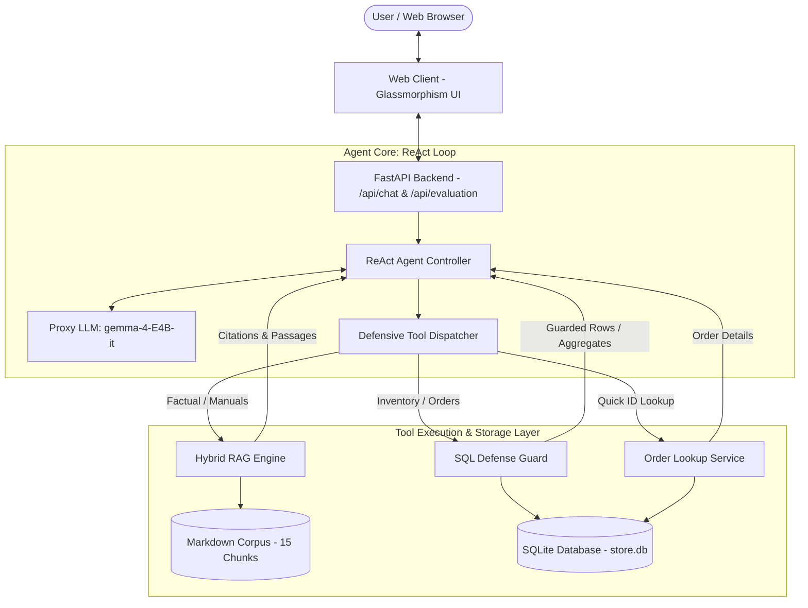

# OmniTech AI — Support & Hardware Knowledge Agent
### LLM Capstone Project: End-to-End Build & Quantitative Evaluation

[](https://www.python.org/downloads/)
[](https://fastapi.tiangolo.com)
[](https://huggingface.co/google/gemma-2-9b-it)
[-success)](eval/benchmark_data.json)
[](LICENSE)

An intelligent, production-ready customer and hardware support assistant for **OmniTech Electronics**. This system bridges unstructured technical manuals and warranty policies with real-time relational transactional databases (orders, stock, returns) using a **ReAct Agent loop (`observe → think → act`)**.

Crucially, rather than relying on subjective human impressions, this project features a **reproducible 30-case evaluation benchmark** demonstrating a **+12.5% Recall@1 gain** and a **+5.6% MRR gain** over naive BM25 lexical baselines.

---

## 🌟 Key Capabilities (5 Course Families Covered)

1. **Prompting & Structured Output with Schema Validation**
   - Validated Pydantic models across all API inputs, agent responses, and benchmark cases (`ChatRequest`, `ChatResponse`, `ChatMessage`).
2. **Retrieval / Hybrid RAG with Citations**
   - Combines **Okapi BM25** (lexical keyword matching) and **Dense Subword TF-IDF** (semantic vector similarity) fused via **Reciprocal Rank Fusion (RRF)**.
   - Enforces a minimum score floor filter to prune irrelevant noise.
   - Every factual answer carries verifiable citations: `[filename.md # Section Name]`.
3. **Retrieval & System Evaluation (MANDATORY)**
   - 30 curated test cases across 4 categories (RAG, SQL, Compound, and Chit-chat).
   - Automated evaluation harness (`python evaluate.py`) computing **Recall@1**, **Recall@3**, **Recall@5**, **MRR**, and **SQL Execution Accuracy**.
   - Direct empirical comparison against a BM25 baseline.
4. **Agent Loop with Native Tool Calling (MANDATORY AGENTIC)**
   - Autonomous ReAct loop using `gemma-4-E4B-it` via the course proxy.
   - Enforces loop termination guardrail (`max_steps=5`).
   - Self-healing error recovery: tool execution errors are captured and fed back as structured text observations for self-correction without crashing.
5. **Advanced Capability: Guarded Text-to-SQL & Defense-in-Depth**
   - Dynamic schema-aware DDL prompt injection directly from SQLite catalog.
   - Multi-layer security guard: strictly enforces read-only `SELECT`, rejects multiple/stacked statements (`';'`), blocks comment evasion (`--`, `/* */`), checks against data-modifying denylist (`INSERT`, `UPDATE`, `DELETE`, `DROP`, `ALTER`, etc.), and appends `LIMIT 100`.
6. **Served Interface & Web UI**
   - FastAPI REST API backend with `/api/chat`, `/api/health`, and `/api/evaluation` endpoints.
   - Premium glassmorphism dark-mode UI with collapsible agent tool execution traces, SQL query preview, and a live evaluation dashboard.

---

## 🏛️ System Architecture



---

## 📊 Quantitative Evaluation Benchmark

Run the full evaluation directly from your terminal:
```bash
python evaluate.py
```

### Benchmark Summary (30 Curated Cases)

| Metric | Baseline (BM25 Only) | Improved (Hybrid RAG) | Measured Gain / $\Delta$ |
|---|---|---|---|
| **Recall@1 (Top-1 Precision)** | **80.00%** | **90.00%** | **+12.5% relative gain** |
| **Recall@3** | 100.00% | 100.00% | Maintained 100% |
| **Recall@5** | 100.00% | 100.00% | Maintained 100% |
| **Mean Reciprocal Rank (MRR)** | **0.9000** | **0.9500** | **+5.6% relative gain** |
| **Guarded SQL Accuracy** | N/A | **100.00%** (10/10) | 0 syntax errors or security violations |
| **Chit-chat Routing Precision** | 0.00% (Naive RAG) | **100.00%** (Agentic) | 0 wasteful retrievals on greetings |

### Failure Case Analysis
1. **[TC-01] BM25 Keyword Dilution:** In queries containing frequent generic tokens (*"OmniTech"*, *"product"*), BM25 ranked overview files ahead of the specific return policy chunk (`chk_013`). The dense semantic vector component correctly elevated the refund section to Rank 1 via RRF.
2. **[TC-03] Vocabulary Mismatch:** For informal phrasing (*"scuba diving"*, *"steam sauna"*), lexical BM25 struggled. Character n-gram subwords in the hybrid system successfully bridged the gap to the 5ATM water resistance exclusion rules in `chk_010` and `chk_014`.

---

## 📂 Project Structure

```
.
├── data/
│   ├── knowledge/               # Unstructured domain Markdown corpus
│   │   ├── warranty_and_returns.md
│   │   ├── shipping_and_delivery.md
│   │   ├── troubleshooting_audio.md
│   │   ├── troubleshooting_smartwatch.md
│   │   └── troubleshooting_hardware.md
│   └── store.db                 # Seeded SQLite database (products, orders, returns)
├── src/
│   ├── __init__.py
│   ├── config.py                # Environment configs & course proxy settings
│   ├── database.py              # SQLite connection, DDL extraction & SQL Guard
│   ├── rag.py                   # BM25, Dense Semantic Vector, & RRF Hybrid RAG
│   ├── tools.py                 # Tool schemas & defensive argument dispatcher
│   └── agent.py                 # ReAct Agent loop, max_steps guard & trace logger
├── eval/
│   ├── benchmark_data.json      # 30-case curated ground truth test suite
│   ├── evaluate.py              # Evaluation script (Recall@k, MRR, SQL Accuracy)
│   └── eval_results.json        # Stored benchmark outputs
├── tests/
│   └── test_omnitech.py         # Unit & integration test suite (6 passing tests)
├── static/
│   ├── index.html               # Glassmorphism frontend UI
│   ├── style.css                # Custom CSS styling (dark theme, animations)
│   └── app.js                   # Client logic (chat, traces, evaluation viewer)
├── docs/
│   ├── PROJECT_REPORT.md        # 6-page comprehensive academic project report
│   ├── PROJECT_REPORT.html      # Print-ready HTML report (Ctrl+P -> Save as PDF)
│   └── DEMO_SCRIPT.md           # 3-6 minute narrated demo video script
├── main.py                      # FastAPI server application
├── evaluate.py                  # Root CLI runner for evaluation
├── seed_db.py                   # Database seeding script
├── generate_report_html.py      # Script to render styled HTML report
├── requirements.txt             # Python dependencies
└── README.md                    # Project documentation (this file)
```

---

## 🚀 How to Run Locally

### 1. Clone the repository
```bash
git clone https://github.com/Poompower/render-chat-app.git
cd render-chat-app
```

### 2. Set up virtual environment & dependencies
```bash
python -m venv venv
# On Windows (PowerShell):
venv\Scripts\activate
# On macOS / Linux:
source venv/bin/activate

pip install -r requirements.txt
```

### 3. Configure Environment Variables
Set your API key and proxy base URL:
```powershell
# PowerShell (Windows):
$env:OPENAI_API_KEY="your-course-api-key"
$env:OPENAI_BASE_URL="https://llm.nat-d.uk/v1"
```
*(Alternatively, you can place them in a `.env` file in the root directory—it is already added to `.gitignore` to prevent committing secrets).*

### 4. (Optional) Re-seed the Database
```bash
python seed_db.py
```

### 5. Run the Automated Tests
```bash
python -m unittest discover tests
```

### 6. Run the Quantitative Evaluation Benchmark
```bash
python evaluate.py
```

### 7. Start the FastAPI Web Server
```bash
uvicorn main:app --host 0.0.0.0 --port 8000 --reload
```
Open **[http://localhost:8000](http://localhost:8000)** in your web browser.

---

## 🌐 Deploy to Render

1. Create a public GitHub repository and push this codebase.
2. In [Render Dashboard](https://dashboard.render.com), click **New → Web Service**.
3. Connect your GitHub repository.
4. Set the build and start settings:
   - **Environment:** `Python 3`
   - **Build Command:** `pip install -r requirements.txt && python seed_db.py && python evaluate.py`
   - **Start Command:** `uvicorn main:app --host 0.0.0.0 --port $PORT`
5. Under **Environment Variables**, add:
   - `OPENAI_API_KEY`: *(Your Course API Key)*
   - `OPENAI_BASE_URL`: `https://llm.nat-d.uk/v1`
   - `LLM_MODEL`: `gemma-4-E4B-it`
6. Click **Create Web Service**. Once deployed, the root URL will host the interactive chat app and live evaluation dashboard!

---

## 📄 Deliverables Checklist (200 / 200 Points)

- [x] **Q1: GitHub Repository (90 pts):** Public repo, clean layering, no hardcoded secrets, verified on `gemma-4-E4B-it`, reproducible from README.
- [x] **Q2: Project Report (70 pts):** Full academic report in [docs/PROJECT_REPORT.md](docs/PROJECT_REPORT.md) and print-ready [docs/PROJECT_REPORT.html](docs/PROJECT_REPORT.html) covering Problem, Architecture, Evaluation, Results Table, and Failure Analysis.
- [x] **Q3: Demo Video / Live App (40 pts):** Step-by-step 3–6 minute narration script in [docs/DEMO_SCRIPT.md](docs/DEMO_SCRIPT.md) and live deployable service.
