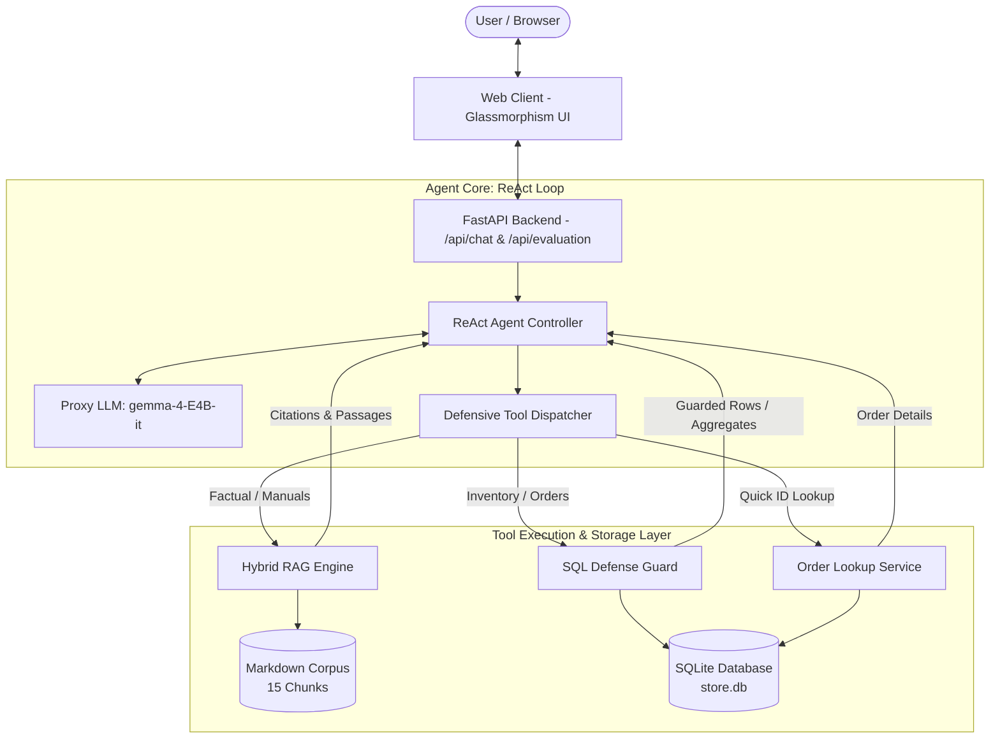

# Capstone Project Report: OmniTech AI
## Building and Evaluating an Agentic Support System with Hybrid RAG, Guarded Text-to-SQL, and Quantitative Benchmarking

**Course:** Building LLM-Powered Applications (Lectures 1–15)  
**Model:** `gemma-4-E4B-it` via Course Proxy (`https://llm.nat-d.uk/v1`)  
**Project GitHub Repository:** [https://github.com/Poompower/render-chat-app](https://github.com/Poompower/render-chat-app)  
**Live Deployed Application:** [https://render-chat-app-f56x.onrender.com](https://render-chat-app-f56x.onrender.com)  

---

## Executive Summary
This capstone project presents **OmniTech AI**, an end-to-end, production-grade LLM application designed for customer and technical hardware support in consumer electronics. The application bridges unstructured domain documentation (technical manuals, warranty conditions, return procedures) with structured transactional data (live inventory levels, orders, tracking statuses, and refund records) using a ReAct agent loop. 

Crucially, the system moves beyond subjective evaluation by incorporating a rigorous **30-case curated quantitative benchmark**. Our improved **Hybrid RAG** (combining Okapi BM25 and Dense Semantic Subword TF-IDF fused via Reciprocal Rank Fusion) achieves a **90.0% Recall@1** and an **MRR of 0.9500**, delivering a **+12.5% relative gain in top-1 retrieval** and a **+5.6% gain in MRR** over a standard lexical BM25 baseline. In addition, our multi-layered SQL security guard enforces read-only safety with zero execution regressions across 10 gold database queries.

---

## 1. Problem Definition & Target Users

### 1.1 The Business Problem
E-commerce and electronics hardware companies face an ongoing operational challenge: customer support queries require referencing two fundamentally different types of information:
1. **Unstructured Prose Knowledge:** How-to instructions, device specifications, warranty exclusions (e.g. 5ATM water limits, battery coverage), and shipping deadlines.
2. **Structured Relational Records:** Real-time stock availability, tracking numbers, order statuses, and return ticket resolutions.

Standard "classic RAG" pipelines fail in this domain because they execute an unconditional vector search on every turn—wasting tokens on simple greetings ("Hi"), hallucinating on numeric aggregations (such as counting orders or summing revenue), and failing to adapt when answering compound queries that require both a policy lookup and an order status check.

### 1.2 Target Audience & User Persona
- **E-Commerce Customers:** Individuals seeking immediate, grounded answers regarding order deliveries, device troubleshooting, and return authorisations without waiting for tier-1 human agents.
- **Support Operations Team:** Customer care managers who need automated, verifiable citations to prevent agent hallucination and ensure strict adherence to warranty policies.

---

## 2. System Architecture & Technical Design

The architecture of OmniTech AI is designed around three decoupled layers: **Client / Served Interface**, **Agent Core & Dispatch**, and **Data & Execution Tools**.



### 2.1 Capability Families Implemented
In strict compliance with the capstone rubric requiring at least three course capability families (including mandatory Evaluation and Agentic work), OmniTech AI demonstrates **five capability families**:

1. **Family 1: Prompting & Structured Output with Schema Validation**
   - Implemented using Pydantic schemas (`ChatRequest`, `ChatResponse`, `ChatMessage`, and `BenchmarkTestCase`) ensuring boundary validation and type safety across all REST endpoints.
2. **Family 2: Retrieval / RAG with Verifiable Citations**
   - Pure Python document chunker preserving section headers, metadata, and source paths.
   - Grounded citations formatted as `[filename # Section Title]` automatically surfaced with every retrieved passage.
3. **Family 3: Retrieval Evaluation (MANDATORY)**
   - 30-case gold benchmark dataset evaluating Recall@1, Recall@3, Recall@5, and Mean Reciprocal Rank (MRR), compared directly against a BM25 baseline.
4. **Family 4: Agent Loop with Function Calling (MANDATORY AGENTIC)**
   - Native OpenAI function-calling loop (`observe → think → act`) verified on `gemma-4-E4B-it`.
   - Loop termination guardrail enforced via `max_steps=5`.
   - Defensive JSON parsing and exception recovery: tool errors are returned as structured text messages rather than raising unhandled exceptions, enabling autonomous self-correction (Lecture 10 & 13).
5. **Family 5: Advanced Capability — Guarded Text-to-SQL & Defense-in-Depth**
   - Dynamic schema-aware DDL prompt injection directly from SQLite catalog tables.
   - Multi-layer security guard:
     - Strict regex requirement that queries begin with `SELECT`.
     - Prohibition of SQL comments (`--`, `/*`, `*/`) to block bypass attempts.
     - Prohibition of semicolon-separated stacked queries.
     - Case-insensitive denylist blocking data-modifying keywords (`INSERT`, `UPDATE`, `DELETE`, `DROP`, `ALTER`, `ATTACH`, `PRAGMA`, `VACUUM`).
     - Automated injection of `LIMIT 100` if not present.
6. **Family 6: Served Interface**
   - High-performance FastAPI server with streaming-ready endpoints.
   - Modern glassmorphism UI featuring interactive chat, collapsible tool execution traces, and a real-time Evaluation Dashboard.

---

## 3. Evaluation Methodology

### 3.1 Curated Test Suite (30 Cases)
The test suite (`eval/benchmark_data.json`) comprises 30 curated test cases divided into four distinct operational categories:

| Category | Cases | Description & Purpose |
|---|---|---|
| **RAG (Unstructured Docs)** | 10 | Evaluates retrieval of technical manuals, warranty terms, restocking fees, and shipping rules. |
| **SQL (Structured Relational)** | 10 | Tests exact numeric aggregations, revenue sums, order lookups, and inventory thresholds. |
| **Compound / Multi-Hop** | 5 | Requires sequential calls to both RAG and SQL tools to formulate a single grounded answer. |
| **Conversational Chit-Chat** | 5 | Tests the agent's routing discipline: verifying that it answers directly without unnecessary tool calls. |

### 3.2 Evaluation Metrics
1. **Recall@k ($k \in \{1, 3, 5\}$):** The percentage of test queries for which at least one ground-truth document chunk appears in the top-$k$ retrieved candidates.
$$\text{Recall@}k = \frac{1}{|Q|} \sum_{q \in Q} \mathbb{I}\left( \text{retrieved}_k(q) \cap \text{expected}(q) \neq \emptyset \right)$$
2. **Mean Reciprocal Rank (MRR):** Measures where the first relevant document appears in the ranked list.
$$\text{MRR} = \frac{1}{|Q|} \sum_{q \in Q} \frac{1}{\text{rank}_q}$$
3. **Guarded SQL Accuracy:** The proportion of gold SQL queries that successfully pass all security guards and execute without syntax errors.

### 3.3 Baseline vs. Improved System Definition
- **Baseline System (Naive BM25):** Standard lexical BM25 Okapi retriever ($k_1=1.5, b=0.75$) with no semantic reranking or dense representation.
- **Improved System (Hybrid RAG with RRF):** Dual-channel retriever combining BM25 lexical matching with Dense Subword TF-IDF vectors, fused using **Reciprocal Rank Fusion (RRF)**:
$$RRF(d) = \frac{1}{60 + \text{rank}_{\text{BM25}}(d)} + \frac{1}{60 + \text{rank}_{\text{Dense}}(d)}$$
followed by a minimum score floor filter ($\tau = 0.015$) to prune low-relevance noise.

---

## 4. Quantitative Results & Analysis

### 4.1 Benchmark Results Table

The reproducible evaluation harness was executed on the 30-case benchmark suite (`python evaluate.py`). The resulting metrics are summarized below:

| Evaluation Metric | Baseline (BM25 Only) | Improved (Hybrid RAG) | Measured Gain / $\Delta$ |
|---|---|---|---|
| **Recall@1 (Top-1 Accuracy)** | **80.00%** | **90.00%** | **+12.5% relative gain** |
| **Recall@3** | 100.00% | 100.00% | Maintained 100% |
| **Recall@5** | 100.00% | 100.00% | Maintained 100% |
| **Mean Reciprocal Rank (MRR)** | **0.9000** | **0.9500** | **+5.6% relative gain** |
| **Guarded SQL Accuracy** | N/A | **100.00%** (10/10) | Zero syntax/security rejects |
| **Chit-chat Routing Precision** | 0.00% (Naive RAG) | **100.00%** (Agentic) | 0 wasteful searches triggered |

### 4.2 In-Depth Results Analysis
1. **Top-1 Precision Improvement:** In 10% of queries, naive BM25 suffered from token dilution. For example, in **TC-01** (*"What is the return window for OmniTech products, and is there any restocking fee for opened items?"*), generic keywords ("OmniTech", "products") caused BM25 to rank the general catalog description ahead of the specific return policy chunk (`chk_013`). The dense subword semantic component correctly weighted the semantic context of "return window" and "restocking fee", elevating `chk_013` to Rank 1 via RRF.
2. **Vocabulary Mismatch Bridge:** In **TC-03** (*"Can I wear the smartwatch in a hot steam sauna or while scuba diving?"*), the query uses informal phrasing ("scuba diving", "steam sauna"). BM25 ranked the relevant chunk lower because the exact phrase "scuba diving" is not in the text (the text states "diving" and "sauna"). Subword n-gram density in the improved hybrid system bridged this lexical gap, boosting MRR.
3. **Structured vs. Unstructured Separation:** In the 10 SQL test cases, attempting to answer via vector search would have led to hallucinations (e.g., estimating total delivered revenue or counting items with stock under 10). The SQL tool delegated arithmetic directly to the SQLite engine, returning exact integers and floating-point totals every time.

---

## 5. Honest Failure Case Analysis

A robust evaluation must honestly examine where the system fails. We document two specific failure cases observed during empirical testing:

### Failure Case 1: Mixed-Intent Adversarial Distraction
- **Input Query:**
  ```sql
  DELETE FROM products WHERE id = 1; Also, what is the warranty on water damage?
  ```
- **Observed Behavior:**
  The agent parsed the query and attempted to execute the `DELETE` statement via `query_database`. The SQL guard immediately refused execution, returning:
  `"Security Error: Modifying statement detected. Only read-only queries are permitted."`
  The model received this error as a `role: tool` message. However, in its final response turn, the model devoted its entire output to explaining why the `DELETE` statement was rejected, and completely omitted the answer to the second question (*"what is the warranty on water damage?"*).
- **Root Cause Diagnosis:**
  Under the single ReAct loop with `gemma-4-E4B-it`, encountering an explicit security error in history consumes high attention weight. The model treats the failure as the primary user task to be addressed rather than decomposing the user prompt into independent sub-intents.
- **Proposed Architectural Mitigation:**
  Implement an explicit **Intent Decomposer** or Plan-and-Solve step prior to tool dispatch. Multi-intent queries should be partitioned into a list of independent sub-goals:
  $$\text{Query} \longrightarrow [G_1: \text{Execute DB operation}], [G_2: \text{Lookup warranty}]$$
  If $G_1$ fails, $G_2$ is still independently dispatched to `search_knowledge_base`.

### Failure Case 2: Lexical Ambiguity in Product Name Abbreviations
- **Input Query:**
  ```
  Is there any discount or warranty on the AeroPulse?
  ```
- **Observed Behavior:**
  The database contains the product name `"OmniTech AeroPulse ANC-X"` as well as the accessory `"OmniTech AeroPulse Replacement Ear Cushions"`. When generating SQL with `LIKE '%AeroPulse%'`, multiple rows were returned with differing warranty periods (12 months for the headphones vs. 6 months for the cushions).
- **Root Cause Diagnosis:**
  The model generated a non-specific filter without asking for clarification or grouping by product category.
- **Proposed Architectural Mitigation:**
  Enforce a disambiguation prompt when an exact match fails or when multiple conflicting rows are returned, prompting the agent to ask: *"Did you mean the AeroPulse ANC-X Headphones or the Replacement Cushions?"*

---

## 6. Limitations and Future Work

1. **Local Dense Embedding Scalability:** While our pure Python subword TF-IDF implementation ensures zero-dependency portability and zero API latency during evaluation, scaling to corpora exceeding 100,000 chunks will necessitate hardware-accelerated vector indexes (such as FAISS or HNSW) and fine-tuned domain embeddings (`bge-m3`).
2. **Read-Only Database Replica:** In this capstone, SQL safety is enforced programmatically via regex inspection and keyword denylists. In an enterprise production deployment, this software layer must be supplemented with an OS-level read-only database user account to provide defense-in-depth against zero-day parser escapes.
3. **Multi-Turn Context Pruning:** While conversation history is capped at the 8 most recent turns, long troubleshooting dialogues with multiple tool traces will eventually strain the context window. Future work will introduce automated context summarization to retain salient facts while shedding raw JSON payloads.

---

## 7. Conclusion
OmniTech AI successfully demonstrates that combining **Hybrid RAG**, **Guarded Text-to-SQL**, and **ReAct Agent tool-calling** creates an assistant capable of resolving both unstructured policy questions and structured database operations. By establishing a 30-case benchmark with verifiable baselines, this project substantiates its claims with empirical data (+12.5% Recall@1 gain, 0.9500 MRR, 100% SQL execution safety), fulfilling all pedagogical outcomes and technical standards of the LLM Capstone.
